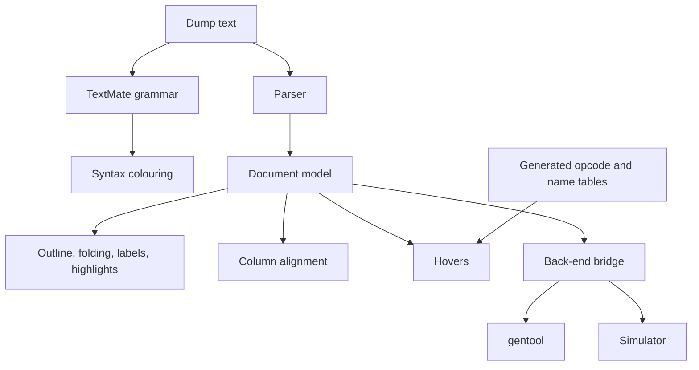

# Architecture

How the extension is built. The input it works on is specified in
[dump-format.md](dump-format.md); the order of work is in
[roadmap.md](roadmap.md).

## 1. Principles

1. **Dumps are read-only artefacts.** People diff them, grep them and attach
   them to bug reports. Nothing the extension does changes a file unless the
   user runs a command that says so.
2. **Mesa defines the syntax.** Tables of opcodes and names are generated from
   a Mesa checkout, not typed in by hand, so they can be regenerated when Mesa
   changes.
3. **Each layer is useful without the next.** Colouring needs no parser; hovers
   need no Mesa build; only the `gentool` bridge and the simulator need
   external programs.
4. **Unknown text is harmless.** A line the parser does not understand
   produces no colour, no hover and no error.

## 2. Components



| Component | Responsibility | Depends on VS Code API |
|---|---|---|
| TextMate grammar | Token colours, by regular expression, line by line | no (declarative JSON) |
| Parser | Text to document model | no |
| Document model | Shaders, labels, instructions, operands, each with a source range | no |
| Providers | Adapt the model to VS Code: symbols, folding, definitions, hovers, highlights, diagnostics | yes |
| Formatter | Compute aligned columns from the model | no |
| Data tables | Opcode descriptions, name tables | no |
| Back-end bridge | Run `gentool` and the simulator, parse what they return | process spawning only |

The parser, model, formatter and tables import nothing from `vscode`. That
keeps them testable with a plain test runner, and it leaves the door open to
moving them behind a language server later without a rewrite. The first
versions run everything in the extension host; a language server is not needed
until a second editor wants the same features.

## 3. Language registration

| Item | Value | Notes |
|---|---|---|
| Language id | `intel-eu-asm` | |
| Display name | Intel EU Assembly (Mesa) | |
| First-line match | `^Native code for ` | Catches shader dumps regardless of file name |
| Extensions | `.euasm` | Unclaimed, for files saved on purpose |
| Line comment | `//` | |

Existing dumps are named `*.asm`, which x86 assembly extensions also claim, so
the extension does not register `.asm`. A dump whose first line is the shader
header is detected anyway. For the rest, the README will document a
`files.associations` entry and the extension contributes a command to switch
the current file's language. Whether first-line detection wins over another
extension's `.asm` claim has to be checked when M1 is built; if it does not,
the fallback is a prompt offered when an `.asm` file contains a
`Native code for` line.

## 4. Grammar and parser

Two mechanisms read the text, on purpose.

The **TextMate grammar** gives colour immediately, on files of any size, and
keeps working on lines the parser rejects. It is limited to what a regular
expression can see on one line. Scopes:

| Token | Scope |
|---|---|
| Opcode | `keyword.mnemonic` |
| Control-flow opcode | `keyword.control` |
| Opcode that is long-running or completes out of order: sends (raw and translated), `dpas`, `math` | `support.function.mnemonic.async` inside `markup.bold` |
| Opcode suffix (`.sat`, `.ugm`, `.exp`) | `entity.name.function` |
| Prefix and predicate (`(W)`, `(f0.0)`) | `keyword.other.predicate` |
| Exec size | `constant.numeric.exec-size` |
| Conditional modifier | `keyword.operator.cmod` |
| General register | `variable.other.register` |
| Architecture register | `variable.language.register` |
| Type suffix | `entity.name.type` |
| Region and swizzle | `string.other.region`, `string.other.swizzle` |
| Source modifier (`-`, `(abs)`) | `keyword.operator.source-modifier` |
| Immediate | `constant.numeric` |
| Send operand length (`r20:1`) | `constant.numeric.length` |
| Option flag | `storage.modifier` |
| Scoreboard annotation | `entity.name.tag.swsb` |
| Label definition and reference | `entity.name.label` |
| Comment | `comment.line.double-slash` |
| Shader header | `markup.heading` |
| Stats line | `meta.stats`, with `markup.bold` on the prefix and `constant.numeric` on the numbers |
| Platform and bytes of a case line or hex prefix | `entity.name.namespace.platform`, `comment.block.bytes` |
| Validator error | `invalid.illegal` |

Scopes were chosen so that stock themes give neighbouring fields different
colours, which is why types and regions do not use `storage.type` and
`punctuation`: in the default dark theme those would be the same blue as the
opcode, or no colour at all.

The grammar colours a line only if it has the shape of an instruction: an
optional predicate, a mnemonic, then an exec size such as `(16)`, or a bare
`nop`. Inside such a line every token rule applies; outside, nothing does. That
is what keeps NIR, jay IR and driver log lines in the same file uncoloured.

The **parser** produces the model every other feature uses. It is hand-written
and line-oriented, mirroring `gen_parse.cpp`: classify the line (header, stats,
label, comment, error, case line, instruction), then tokenise instruction
fields left to right. Every node records its range, so a hover or an alignment
edit can address the exact characters.

Semantic tokens from the parser can later refine the grammar's colours, for
example to mark a register that is written but never read. That is optional and
not planned for a specific milestone.

The whole document is parsed at once and the result cached per document
version, so all providers share one parse. A 12 000-line dump takes about
40 ms, which makes incremental parsing unnecessary for now; it becomes worth
doing if logs of several hundred thousand lines are edited rather than read.

## 5. Column alignment

The printer already aligns to fixed columns; lines go wrong only where a field
overflows. Alignment therefore means recomputing column positions for a range
so every line in it agrees.

Two ways to deliver it:

| | Formatter | Display-only |
|---|---|---|
| Mechanism | `DocumentFormattingEditProvider` rewrites whitespace | Decorations pad the rendering, the file is untouched |
| File changes | Yes, whitespace only | No |
| Works with diff, copy, search | Yes | Copy gives the original spacing |
| Cost | Low | Higher: decoration per misaligned line, must track scrolling and edits |

The formatter is what was built. It runs only by explicit command (Format
Document or Format Selection); the extension turns format-on-save off for the
language. It changes whitespace alone, so a formatted dump still diffs cleanly
with `-w`. Display-only alignment is a later option if rewriting turns out to
be unwelcome in practice.

The formatter models the printer directly. Every field of a line is assigned
a slot (prefix, opcode, cmod, the operand slots of its instruction format,
options, comment), each slot has the column `gen_print.cpp` pads to, and a
field starts at its column if the cursor has not passed it and after one space
otherwise. With the printer's own columns this reproduces Mesa's output
exactly, which is both the test of the model and the `printer` setting that
undoes an alignment. Aligning is the same procedure with each column moved
right until no line overflows it.

Rules:

- Columns are computed per shader, not per file, so one long field in one
  shader does not widen every other shader.
- Each instruction format has its own operand columns, as in the printer:
  ALU, send (raw and translated) and branch. The prefix, opcode, cmod, options
  and comment columns are shared.
- An outlier does not set the width. A field that overflows its printer column
  by more than `intelEuAsm.format.maxOverflow` characters (default 12) is left
  overflowing, and the rest of that line follows at one space until it falls
  back onto a column.
- Lines the parser did not fully understand are left exactly as they are, as
  are headers, labels, comment lines and anything that is not assembly.
- A selection is formatted with the columns of its whole shader, so it agrees
  with the lines around it.

Two consequences worth knowing. A shader with any three-source instruction
(`dpas`, `mad`, `bfn`) gets its options column moved right for every line,
because the third source occupies the printer's options column. And a shader
with a nine-character prefix such as `(W&~f0.0)` gets every opcode moved two
columns right.

## 6. Hovers

Each hover is computed from the model node under the cursor plus the tables.

The opcode hover is specific to the kind of instruction, and is where most of
the value is. What each kind shows is specified under M4 in
[roadmap.md](roadmap.md).

| Hover on | Shows |
|---|---|
| Opcode | The instruction explained as a whole; see the roadmap |
| Operand | The full form: `r0.1<0>` becomes `r0.1<0;1,0>:ud`, byte offset 4, scalar broadcast |
| Immediate | Other readings: `0x3fb8aa3b:f` as 1.4427, a `:uq` gather list as register numbers |
| Exec size | Channels covered, register footprint for the destination type |
| Predicate or cmod | What the flag gates or receives |
| Scoreboard annotation | The instruction it waits on, found by counting back in the pipe or by matching the token; a link to it |
| Label | The target line, and the instructions that branch to it |
| Send descriptor | Field-by-field decode of `desc` and `ex_desc` |
| Stats line field | What the number counts |

The hover text is built by pure functions in `src/hover/` that return
Markdown; the provider only wraps it. Links to other lines are ordinary links
to the document with a line fragment, so they need no command and no trusted
Markdown.

Mesa's opcode list is generated by `tools/gen-opcodes.py` from
`gen_opcodes.py` and committed as `data/opcodes.json`, so building the
extension does not need a Mesa checkout. Prose descriptions cannot be generated
and live in `src/hover/opcodes.ts`, keyed by mnemonic; a test fails when the
two lists differ. The send decoder in `src/hover/lsc.ts` is a transcription of
`gen_lsc_desc_decode()` and the translated-send printer, and is tested by
decoding every send in the corpus and comparing with the name the printer put
in the comment.

What depends on the platform (register size, descriptor layout, cache-control
encoding) is driven by the `intelEuAsm.generation` setting, since a shader dump
does not record its platform. Case-file lines name theirs and use that.

## 7. Back-end bridge

A thin layer that runs an external program and turns its output into model
data. Everything here is optional and off until configured.

**`gentool`** is the first back end. It already offers what the editor needs:

| Command | Use in the editor |
|---|---|
| `gentool disasm -p P [--hex] [-v] [--translated-sends]` | Open a binary as a listing; re-print a listing in verbose or translated form in a side view |
| `gentool asm -p P` | Assemble the current file or selection; report parse and validation errors as diagnostics |
| `gentool region -p P` | Draw the register bytes one instruction touches, in a hover or panel |

Settings: the path to `gentool` and the platform. The commands are always
listed; one run with no path configured offers a file dialog to set it.

`src/backend/gentool.ts` holds everything that talks to the process and uses
only Node's API, so it is tested by running the real binary. It feeds gentool
through stdin and reads stdout, so no temporary files are written. A dump is
first reduced to what `gentool asm` accepts, line for line, so that the line
numbers in its errors need no translation. A re-printed listing goes the other
way: gentool's output is laid back over the original line by line, so the
view keeps the original's line numbers and the two editors can be scrolled as
one. `src/commands.ts` wraps that in
commands, diagnostics and the hover.

**The simulator** is the long-term goal: step through a listing and watch
registers, flags and the execution mask change. VS Code's Debug Adapter
Protocol is the natural fit, because it supplies stepping, breakpoints and a
variables view without custom UI. The bridge would then be a debug adapter
that maps listing lines to instruction addresses and translates between the
protocol and the simulator.

Which simulator, and how it is driven, is undecided and is the main open
question in [roadmap.md](roadmap.md). The model is designed so that it does not
matter yet: every instruction has a stable index and, when bytes are present,
an address.

## 8. Repository layout

```
package.json            extension manifest
language-configuration.json
syntaxes/intel-eu-asm.tmLanguage.json
src/
  extension.ts          activation and the providers, which are thin adapters
  parser/               line classifier, tokeniser, model types
  analysis/             folding and reference queries over the model
  format/               column alignment
  hover/                hover text, send decoding, opcode descriptions
  backend/              gentool runner; simulator adapter     (M6)
  commands.ts           the gentool commands and diagnostics
data/                   generated tables, hand-written descriptions
tools/                  generators that read a Mesa checkout
test/
  corpus/               round-trip case files and sample dumps
  tokenize.test.cjs     grammar test
  parser.test.ts        parser and analysis tests
docs/
```

## 9. Tooling

| Choice | Reason |
|---|---|
| TypeScript | The VS Code extension API is typed for it |
| esbuild, single bundle | Fast builds, small package, no runtime dependencies |
| Erasable TypeScript only (no enums or namespaces) | Node 24 runs the sources directly, so tests need no build step |
| No runtime npm dependencies | The parser is small and specific; nothing off the shelf fits this syntax |
| Node's built-in test runner for parser, formatter and tables | They do not need an editor to run |
| `@vscode/test-electron` for provider tests | Needed only for the thin adapter layer |

## 10. Testing

Mesa's `tests/*.txt` hold about 3000 instruction lines across platforms, in
default, verbose and translated forms. The core parser test is: every one of
those lines parses completely. Two hand-written sample listings add coverage
for headers, labels, stats lines, comments and control flow.

The Mesa files are copied into `test/corpus/mesa/` with a note of the commit
they came from.
